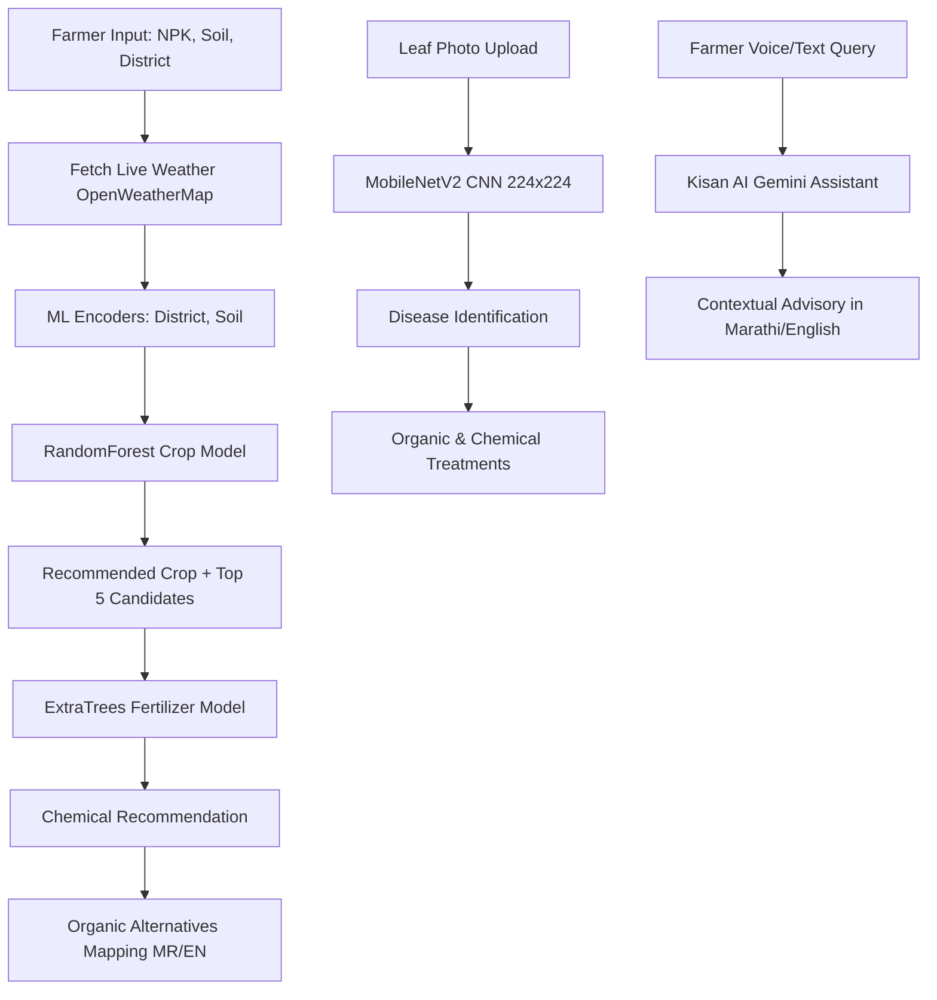

# 🌱 Farm Genius (फार्म जीनियस)

> **AI-Powered Smart Agriculture & Decision Support System tailored for Maharashtra Farmers.**  
> *Providing real-time crop advisory, disease diagnostics, fertilizer planning, market prices, and yield forecasting in both Marathi (मराठी) and English.*

---

## 📌 Table of Contents

- [Overview](#-overview)
- [Key Features](#-key-features)
- [System Architecture](#-system-architecture)
- [Tech Stack](#-tech-stack)
- [Project Directory Structure](#-project-directory-structure)
- [Machine Learning & AI Pipeline](#-machine-learning--ai-pipeline)
- [Prerequisites](#-prerequisites)
- [Installation & Local Setup](#-installation--local-setup)
  - [1. Clone Repository](#1-clone-repository)
  - [2. Backend Setup (Flask API)](#2-backend-setup-flask-api)
  - [3. Frontend Setup (React + Vite)](#3-frontend-setup-react--vite)
- [Environment Configuration](#-environment-configuration)
- [API Documentation](#-api-documentation)
- [Deployment](#-deployment)
- [Screenshots & UI Highlights](#-screenshots--ui-highlights)
- [Contributing & License](#-contributing--license)

---

## 🌾 Overview

**Farm Genius** is an intelligent agricultural web platform designed to bridge the gap between advanced machine learning agronomy models and grassroots farming communities. Built specifically with **Maharashtra's soil profiles, weather dynamics, and staple crops** in mind, it empowers farmers to make data-backed choices from sowing to harvest.

The application features full bilingual support (**मराठी** & **English**) so farmers can operate in their native language seamlessly.

---

## 🚀 Key Features

### 1. 🌿 Intelligent Crop Recommendation
- Recommends the highest-yielding crop based on soil nutrients ($N, P, K$), soil pH, moisture, soil color, and geographical district.
- Automatically fetches **real-time local weather and rainfall forecasts** using OpenWeatherMap.
- Displays top-5 probabilistic candidates suited for the region.

### 2. 🧪 Fertilizer & Organic Alternatives
- Powered by an ensemble ML model predicting targeted chemical fertilizers (Urea, DAP, 10:26:26 NPK, 19:19:19 NPK, etc.).
- Delivers practical **organic and bio-fertilizer alternatives** (Jeevamrut, Vermicompost, FYM, Wood Ash, Bone Meal) in Marathi and English to encourage sustainable organic farming.

### 3. 🍂 Computer Vision Leaf Disease Detection
- Deep learning leaf analysis using **MobileNetV2 CNN** (`model.h5`).
- Diagnoses bacterial, fungal, and pest diseases for key Maharashtra staples:
  - **Cotton (कापूस)**
  - **Sugarcane (ऊस)**
  - **Rice (भात)**
  - **Maize (मका)**
  - **Wheat (गहू)**
  - **Soybean (सोयाबीन)**
- Returns confidence scores, causes, and step-by-step organic and chemical treatment advice.

### 4. 📈 Yield & Net Profit Estimator
- Predicts expected yield in **quintals per hectare** and total harvest weight (kg).
- Calculates economic estimates including:
  - **Gross Revenue** based on local APMC mandi price indices.
  - **Tractor & Machinery Costs**.
  - **Labor & Operational Expenditure**.
  - **Estimated Net Farmer Profit**.

### 5. 📊 Live Mandi Market Prices
- Real-time market price discovery across Maharashtra APMC mandis.
- Shows minimum, maximum, and average modal prices per quintal to help farmers sell at the best rate.

### 6. 🤖 Kisan AI Chatbot (शेतकरी मित्र)
- Multilingual farming assistant powered by **Google Gemini AI**.
- Answers queries on soil health, irrigation schedules, pest management, weather advisories, and government schemes in natural Marathi and English.

---

## 🛠 Tech Stack

### Frontend
- **Framework**: [React 19](https://react.dev/) + [Vite](https://vitejs.dev/)
- **Styling**: [Tailwind CSS](https://tailwindcss.com/)
- **Routing**: [React Router v7](https://reactrouter.com/)
- **Icons**: [Lucide React](https://lucide.dev/)
- **HTTP Client**: [Axios](https://axios-http.com/)

### Backend
- **Framework**: [Flask 3.x](https://flask.palletsprojects.com/) (Python 3.9 – 3.11)
- **WSGI Server**: [Gunicorn](https://gunicorn.org/)
- **Security & Auth**: [PyJWT](https://pyjwt.readthedocs.io/), CORS, Werkzeug Security
- **Database**: SQLite / SQL lightweight store

### Machine Learning & Data Science
- **Computer Vision**: [TensorFlow](https://www.tensorflow.org/) / Keras (`MobileNetV2`)
- **Tabular ML**: [Scikit-Learn](https://scikit-learn.org/) (`RandomForestClassifier`, `ExtraTreesClassifier`)
- **Data Manipulation**: [Pandas](https://pandas.pydata.org/), [NumPy](https://numpy.org/)
- **Model Serialization**: `joblib`
- **Generative AI**: Google Gemini API (`google-generativeai`)

---

## 📂 Project Directory Structure

```text
farma/
├── backend/
│   ├── app.py                     # Main Flask application & blueprint registrations
│   ├── requirements.txt           # Python backend dependencies
│   ├── model.h5                   # MobileNetV2 trained disease classification weights
│   ├── config/
│   │   ├── labels.json            # Disease class mapping & treatment guides
│   │   └── advice_pack.json       # Farmer advisory and bilingual guidelines
│   ├── models/                    # Scikit-learn models & encoders
│   │   ├── crop_model.pkl         # Crop prediction classifier
│   │   ├── fertilizer_model.pkl   # ExtraTrees fertilizer classifier (~287MB)
│   │   ├── crop_encoder.pkl       # LabelEncoder for crops
│   │   ├── district_encoder.pkl   # LabelEncoder for Maharashtra districts
│   │   ├── fert_encoder.pkl       # LabelEncoder for fertilizers
│   │   └── soil_encoder.pkl       # LabelEncoder for soil types
│   ├── routes/
│   │   ├── auth.py                # Login, signup & JWT authentication
│   │   ├── chatbot.py             # Gemini AI chatbot integration
│   │   ├── market.py              # APMC mandi commodity prices
│   │   ├── ml_api.py              # Crop, fertilizer & disease ML endpoints
│   │   └── weather_bp.py          # Weather forecast routing
│   └── utils/
│       ├── db.py                  # Database initialization & price queries
│       ├── disease_predict.py     # Image preprocessing & inference
│       ├── farmer_economics.py    # Revenue & cost calculation formulas
│       ├── farmer_recommend.py    # Agronomic calendar & steps
│       ├── ml_models.py           # ML models loader & fallback rules
│       └── weather.py             # OpenWeatherMap API client
├── frontend/
│   ├── package.json               # NPM packages and scripts
│   ├── vite.config.js             # Vite configuration
│   ├── src/
│   │   ├── App.jsx                # Core router and provider wrapper
│   │   ├── main.jsx               # React entry point
│   │   ├── components/            # Layout, ChatbotWidget, ConfidenceBar, etc.
│   │   ├── context/               # Auth & Language (MR/EN) state management
│   │   ├── pages/
│   │   │   ├── Dashboard.jsx      # Overview dashboard with live weather & quick actions
│   │   │   ├── Recommend.jsx      # Crop & Fertilizer recommendation form
│   │   │   ├── Disease.jsx        # Leaf image uploader & disease report
│   │   │   ├── Yield.jsx          # Yield & profit calculation tool
│   │   │   ├── Market.jsx         # Mandi market price browser
│   │   │   ├── AuthLogin.jsx      # Farmer login
│   │   │   └── AuthRegister.jsx   # Farmer registration
│   │   └── utils/                 # API client & locale translations
├── .env.example                   # Sample environment configuration
└── README.md                      # Project documentation
```

---

## 🧠 Machine Learning & AI Pipeline



---

## 💻 Prerequisites

Ensure you have the following installed:
- **Node.js**: v18.0.0 or higher
- **Python**: v3.9, 3.10, or 3.11
- **pip** / **npm**
- **Git**

---

## ⚙️ Installation & Local Setup

### 1. Clone Repository

```bash
git clone https://github.com/Prathmesh00796/Project---Farm-Genius.git
cd Project---Farm-Genius
```

### 2. Backend Setup (Flask API)

1. Open a terminal and navigate to `backend`:
   ```bash
   cd backend
   ```

2. Create and activate a Python virtual environment:
   ```bash
   # Windows (PowerShell)
   python -m venv venv
   .\venv\Scripts\Activate.ps1

   # Linux / macOS
   python3 -m venv venv
   source venv/bin/activate
   ```

3. Install dependencies:
   ```bash
   pip install -r requirements.txt
   ```

4. Create your `.env` file from the example:
   ```bash
   # From root or inside backend
   cp ../.env.example .env
   ```
   *(Update your API keys as detailed in [Environment Configuration](#-environment-configuration).)*

5. Verify or download ML models:
   - Ensure `model.h5` is in `backend/`.
   - The fertilizer model (`models/fertilizer_model.pkl`) will auto-download from Hugging Face on first run if not already present.

6. Start the Flask development server:
   ```bash
   python app.py
   ```
   *The backend will be running at:* `http://127.0.0.1:5000`

---

### 3. Frontend Setup (React + Vite)

1. Open a second terminal and navigate to `frontend`:
   ```bash
   cd frontend
   ```

2. Install JavaScript packages:
   ```bash
   npm install
   ```

3. Launch the development server:
   ```bash
   npm run dev
   ```
   *The web app will be accessible at:* `http://localhost:5173`

---

## 🔑 Environment Configuration

Create a `.env` file in the project root or inside `backend/`:

```env
# ---------------------------------------------
# Farm Genius Environment Configuration
# ---------------------------------------------

# OpenWeatherMap API Key (Get a free key from https://openweathermap.org/)
OPENWEATHER_API_KEY=your_openweather_api_key_here

# JWT Secret for farmer authentication
FARM_GENIUS_JWT_SECRET=your_super_secret_jwt_key_here

# Google Gemini API Key (Get a free key from https://aistudio.google.com/)
GEMINI_API_KEY=your_gemini_api_key_here

# Gemini Model Selection (default: gemini-1.5-flash)
GEMINI_MODEL=gemini-1.5-flash

# Optional: Disease Model Preprocessing (standard MobileNetV2 or raw255)
# FG_DISEASE_PREPROCESS=raw255
```

---

## 📡 API Documentation

| Method | Endpoint | Description | Payload / Params |
| :--- | :--- | :--- | :--- |
| `GET` | `/health` | Healthcheck & model readiness | None |
| `POST` | `/recommend-crop` | Recommend best crop & fertilizer | `{ city, N, P, K, pH, moisture }` |
| `POST` | `/predict-disease` | Diagnose leaf disease from photo | `multipart/form-data`: `image`, `crop`, `?lang=mr` |
| `POST` | `/predict-yield` | Calculate farm yield & financial profit | `{ crop, N, P, K, pH, rain_mm, area_ha }` |
| `GET` | `/market-prices` | Fetch current APMC mandi prices | `?crop=Cotton` |
| `POST` | `/chat` | Kisan AI chat assistant | `{ message: "ऊस पिकावर कीड पडली आहे" }` |
| `POST` | `/register` | Farmer account registration | `{ name, phone, password, district }` |
| `POST` | `/login` | Farmer account authentication | `{ phone, password }` |

---

## 🚢 Deployment

### Production WSGI (Gunicorn)
To run the backend with Gunicorn in production:
```bash
cd backend
gunicorn --bind 0.0.0.0:5000 --workers 2 --timeout 120 app:app
```

### Docker
A production `Dockerfile` and `docker-compose.yml` are included in the repository:
```bash
# Build and run containers
docker-compose up --build -d
```

### Cloud Platforms (Render / Railway)
- **Web Service Root**: `backend`
- **Build Command**: `pip install -r requirements.txt`
- **Start Command**: `gunicorn --bind 0.0.0.0:$PORT --workers 1 --timeout 120 app:app`
- Add environment variables in the platform dashboard.

---

## 🌍 Language & Accessibility

- **मराठी (Marathi)**: Tailored terminology for Maharashtra farmers (उदा. *शेणखत, गांडूळखत, जीवामृत, खुरपणी, बाजारभाव*).
- **English**: Complete international interface and scientific advisory terminology.

---

## 👥 Contributing

Contributions, feedback, and issue reports are warmly welcomed!
1. Fork the Project.
2. Create your Feature Branch (`git checkout -b feature/AmazingFeature`).
3. Commit your Changes (`git commit -m 'Add some AmazingFeature'`).
4. Push to the Branch (`git push origin feature/AmazingFeature`).
5. Open a Pull Request.

---


<div align="center">
  <b>Farm Genius — समृद्ध शेतकरी, प्रगत महाराष्ट्र 🌾</b>
</div>
